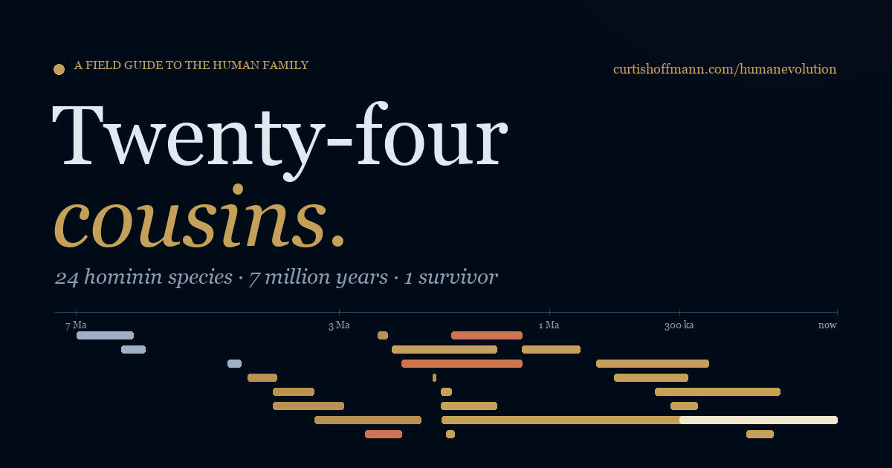

# Twenty-Four Cousins

A field guide to the human family, in one page: twenty-four hominin species, seven million years, one survivor.

Live at **https://curtishoffmann.com/humanevolution/**



## What it does

- **Time slider.** Drag from seven million years ago to the present and watch which species are alive at that moment, with a short note on what was happening.
- **Timeline.** Every species as a bar, oldest at the top, on a square-root time axis so the crowded last half-million years stay readable.
- **Brain story.** Cranial capacity against time for the 22 species with a measurable skull, with the spread of published values for each.
- **Trait grid.** Bipedalism, feet, hands, hip, posture, jaw, brow ridge, prognathism, diet and tool industry, side by side.
- **Compare.** Any two species face to face.
- **Species profiles.** Each species has a profile with dates, brain size, stature, discovery details, a status note on how secure the name is, and the sources behind every number. Profiles have permanent links, for example `https://curtishoffmann.com/humanevolution/#homo-naledi`.

Everything is plain HTML, CSS and JavaScript. There is no framework, no tracking, and the only outside request is for two Google Fonts.

## Where the numbers come from

The quantitative values (time ranges, cranial capacities, heights, discovery years and sites) were compiled on 14 October 2026 from:

- the Smithsonian Human Origins Program species and fossil pages,
- the Australian Museum human-evolution species pages,
- and primary papers where those two are silent: Lebatard et al. 2008 (PNAS) for the Chad sites, Ferring et al. 2011 (PNAS) and Lordkipanidze et al. 2007 (Nature) and 2013 (Science) for Dmanisi, Grün et al. 2020 (Nature) for Kabwe.

Each species in `data/species.json` lists which of those it relies on, and carries a short note explaining each value. A line-by-line table of old and new values with sources is in the working notes that accompanied the rebuild.

The qualitative trait descriptors (the grid and the anatomy block in each profile) are carried over from a small Kaggle teaching dataset, "Biological Data of Human Ancestors" by santiago123678. They are categorical summaries, not measurements, and they are labelled as such on the page.

The species list is also the Kaggle list. Twenty-four is not a verdict on how many hominin species existed. *Homo georgicus* is usually placed within *Homo erectus* and *Homo rhodesiensis* within *Homo heidelbergensis*, while *Ardipithecus kadabba*, *Kenyanthropus platyops*, *Homo luzonensis* and the Denisovans are missing. The page says so, and each profile notes where its name stands.

### A note on the earlier version

The first release of this page drew its charts from a 12,000-row CSV, now parked in `data/legacy/` with a note. That file was a random expansion of the Kaggle set: every species had exactly 500 rows, a one-million-year span and a 300 cc brain range, which is why the old charts showed *Homo sapiens* living a million years ago. Those numbers have been replaced; the file is kept only for the record.

## Repository layout

```
index.html            built page (do not edit by hand; run build.py)
src/template.html     page template
build.py              embeds data/species.json into the template and renders the species index
data/species.json     the dataset, with per-value notes and sources
data/LICENSE          CC BY 4.0 for the dataset
data/legacy/          the Kaggle teaching set and the first release's derived files, with a note
assets/styles.css     stylesheet
assets/app.js         slider, timeline, chart, trait grid, compare, profile panel
assets/og-image.png   social preview (1200×630)
assets/favicon.svg    icon, plus PNG fallbacks
robots.txt, sitemap.xml
LICENSE               MIT, for the code
```

## Working on it locally

Edit `data/species.json` or `src/template.html`, then rebuild:

```bash
python3 build.py
```

Open `index.html` directly in a browser, or serve the folder:

```bash
python3 -m http.server 8000
```

and visit http://localhost:8000/. No dependencies beyond Python 3.

## Changing the data

Each species entry has `time`, `cranial_cc` and `height_cm` blocks with `min`, `max`, `mean` and a `note`, plus `found`, `named`, `type_site`, `status` and a `sources` list that refers to keys in the top-level `sources` object. Add a source there first, then cite it. A value that is unknown should be `null`, not a guess; the page renders a dash and the chart leaves the species out.

## Licence

Code is released under the MIT Licence. The compiled dataset in `data/species.json` is released under CC BY 4.0; please cite the underlying sources listed on the page when reusing it.

Made by [Curtis Hoffmann](https://curtishoffmann.com/).
